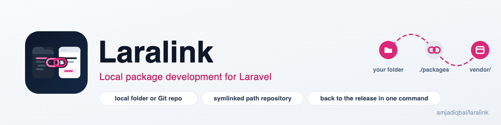
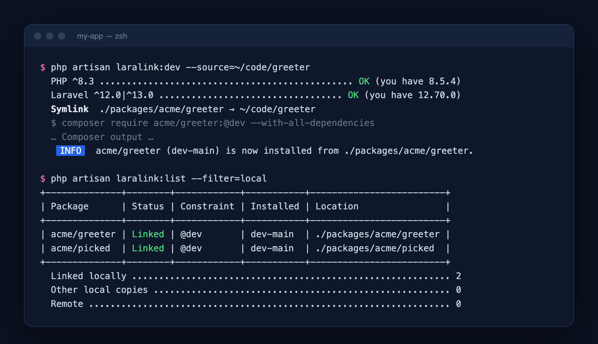

<p align="center">
  <picture>
    <source media="(prefers-color-scheme: dark)" srcset="art/banner-dark.png">
    
  </picture>
</p>

# Laralink: local package development for Laravel

Work on a Composer package inside the Laravel app that uses it. One artisan command links the package from a
local folder or a Git repository through a symlinked Composer path repository, so every edit shows up in the
app immediately. A second command switches it back to the released version from Packagist when you're done.

[](https://packagist.org/packages/amjadiqbal/laralink)
[](https://packagist.org/packages/amjadiqbal/laralink)
[](LICENSE.md)

<p align="center">
  
</p>

```bash
composer require amjadiqbal/laralink --dev

php artisan laralink:dev --source=~/code/my-package   # link a folder on your machine
php artisan laralink:dev vendor/package --branch=fix   # or clone a branch from GitHub
php artisan laralink:list                              # what is linked, what is installed
php artisan laralink:publish vendor/package            # back to the Packagist release
```

## Why this package

Composer can already install a package from a local folder: you add a `path` repository to `composer.json`,
require the package at `@dev`, and later undo both and restore the constraint you had. Laralink does those
steps for you and makes them safe to repeat:

- **One command to link.** From a folder (symlinked, or copied with `--copy`) or any Git URL and branch. The
  path repository goes first in `composer.json`, so it wins over Packagist and any other repository.
- **Checks before it touches anything.** The package's own PHP and Laravel constraints are compared with your
  app's versions using Composer's semver rules, so a mismatch is one clear line instead of a page of solver
  output.
- **Undoes its own changes.** If Composer can't install the package, `composer.json` is restored and the link
  or clone it just made is removed.
- **Remembers what you had.** `laralink:publish` puts back the exact constraint the package had before you
  linked it (for example `^2.3` in `require-dev`), or the latest release if it wasn't required before.
- **Careful with your code.** Removing a symlinked package only removes the symlink; your source folder is never
  touched. A cloned package with uncommitted changes is not deleted unless you back it up or force it.

## Requirements

- PHP 8.3+
- Laravel 12 or 13
- Composer 2 and Git on your `PATH`
- macOS or Linux (symlinks; on Windows use `--copy`)

## Installation

```bash
composer require amjadiqbal/laralink --dev
```

The service provider is discovered automatically. There is nothing to publish or configure. Add `/packages`
to your app's `.gitignore` if you don't want linked packages committed.

## Usage

### Link a package: `laralink:dev`

```bash
php artisan laralink:dev [vendor/package] [--source=] [--branch=] [--copy] [--skip-version-check] [--force]
```

| Option | What it does |
|---|---|
| `--source=` | A folder (absolute, relative or `~/...`) or a Git URL: `https://`, `git@host:...`, `ssh://`, `file://`. |
| `--branch=` | Branch or tag to clone. Default: the repository's default branch. |
| `--copy` | Copy a local folder into `./packages` instead of symlinking it (`.git`, `vendor`, `node_modules` are skipped). |
| `--skip-version-check` | Don't compare the package's PHP/Laravel constraints with your app. |
| `--force` | Point an existing symlink somewhere else, and skip the version check. |

```bash
# Interactive: pick "A local path" or "A Git repository". Packages in folders next to your
# app (../*, ../*/*) and in ~/projects are listed for you to choose from.
php artisan laralink:dev

# A folder on your machine: ./packages/vendor/package becomes a symlink to it
php artisan laralink:dev --source=../my-package

# A package by name, cloned from https://github.com/vendor/package.git
php artisan laralink:dev vendor/package

# Any Git URL and branch, e.g. a colleague's fork
php artisan laralink:dev --source=git@gitlab.com:acme/billing.git --branch=feature/invoices
```

What happens, in order:

1. The package's `composer.json` is read (after cloning, for Git sources) and its `name` decides where it goes:
   `./packages/vendor/package`.
2. Its `php` and `laravel/framework` / `illuminate/*` constraints are checked against your app.
3. The folder is symlinked, copied or cloned into `./packages/vendor/package`.
4. A path repository with `"symlink": true` is added first in your `composer.json`.
5. `composer require vendor/package:@dev --with-all-dependencies` runs (with `--dev` if the package was in
   `require-dev`). `vendor/vendor/package` is now a symlink, so edits are live without `composer update`.

If a package is already linked, the command says so and stops. If `./packages/vendor/package` exists but isn't
linked (for example after `laralink:publish` without `--delete`), `php artisan laralink:dev vendor/package`
links those files as they are.

### See what is linked: `laralink:list`

```bash
php artisan laralink:list                 # table of every package with its status
php artisan laralink:list --filter=local  # only packages in ./packages (or --filter=remote)
php artisan laralink:list --json          # for scripts and CI
```

Each row shows the constraint from `composer.json`, the version installed according to `composer.lock`, and a
status: **Linked**, **Local files, not linked** (in `./packages` but without a path repository), **Linked, not
required**, or **Remote**. The JSON has the same fields plus `source` (the symlink target or the Git URL).

### Switch back: `laralink:publish`

```bash
php artisan laralink:publish [vendor/package] [--delete] [--backup] [--force]
```

| Option | What it does |
|---|---|
| `--delete` | Also remove `./packages/vendor/package`. A symlink is unlinked; the folder it points to is not touched. |
| `--backup` | With `--delete`, copy the files to `./packages/.backups/vendor/package-<date>` first (Git history included). |
| `--force` | Skip the confirmation, and delete a clone even if it has uncommitted changes. |

The path repository is removed and Composer installs the constraint the package had before it was linked, or
the latest release (`composer require vendor/package`) if it wasn't required before. If no released version
can be installed (for example the package isn't on Packagist yet), `composer.json` is restored and the
package stays linked. Without a package name it asks which linked package to switch back.

### `php artisan about`

Laralink adds its installed version and a support link to `php artisan about`. Nothing else is printed and it
makes no network calls.

## Testing

```bash
composer test
scripts/ci-local.sh   # every PHP 8.3–8.5 × Laravel 12/13 combination, Pint and PHPStan
```

## Need this built into your app, or something custom?

I build Laravel packages, internal tooling and features for teams. If you want a package extracted from your
app, a private package set up for your team, or something this package doesn't do,
[get in touch](https://amjad.com.pk/contact?utm_source=github&utm_medium=readme&utm_campaign=laralink).

## Support

- 🐛 **Bug or feature request**: [open an issue](https://github.com/amjadiqbal/laralink/issues)
- 🔒 **Security issue**: please report privately via GitHub's security tab

## Need this customised, or something built?

I'm available for custom development, package integration, and technical consulting.

[](https://www.upwork.com/freelancers/amjadkhatri)

## More packages

Part of a family of open-source packages. See [all of them](https://github.com/amjadiqbal?tab=repositories).

| | |
|---|---|
| [kiln](https://github.com/amjadiqbal/kiln) | Deploy-time OPcache control for Laravel |
| [laravel-driver-js](https://github.com/amjadiqbal/laravel-driver-js) | Product tours and onboarding for Laravel |
| [laravel-logpulse](https://github.com/amjadiqbal/laravel-logpulse) | Log health monitoring and alerting |
| [laravel-tiptap](https://github.com/amjadiqbal/laravel-tiptap) | Tiptap editor for Laravel |

## Credits

- [Amjad Iqbal](https://amjad.com.pk)

## License

MIT. See [LICENSE.md](LICENSE.md).
